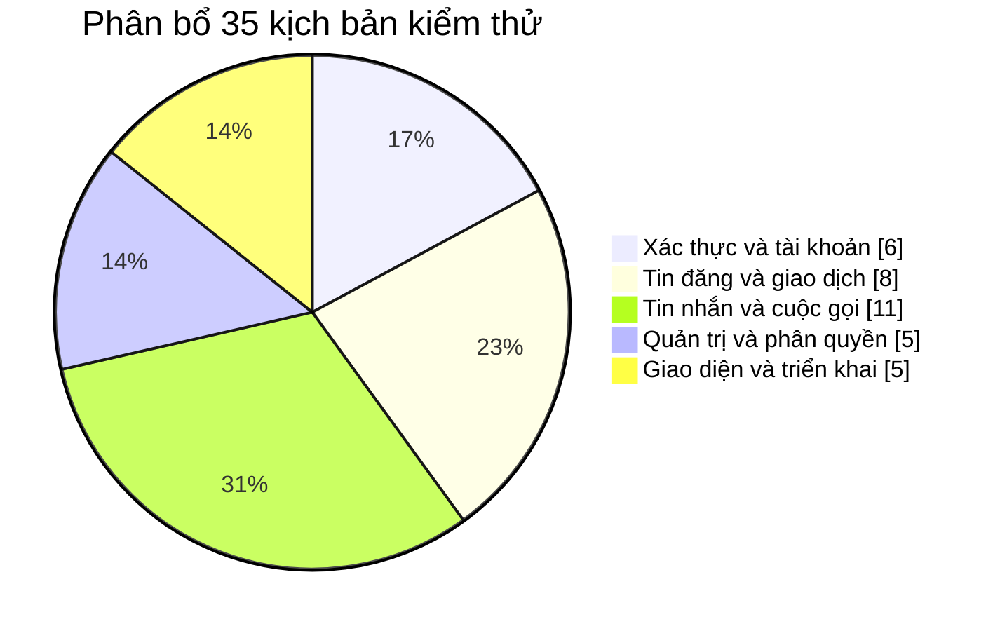

# Chợ Hời
hùng long dũng

Nền tảng rao vặt trực tuyến cho mua bán đồ cũ, đồ mới và kết nối người mua với người bán ở gần.

## Yêu cầu

- Java 21
- Node.js 20.19+ hoặc 22.12+
- PostgreSQL 15+

## Cấu hình database PostgreSQL

Nhóm có thể dùng chung database PostgreSQL trên Neon khi chạy ứng dụng local:

1. Mỗi thành viên sao chép `.env.example` thành `.env` ở thư mục gốc dự án.
2. Điền `DB_PASSWORD` bằng mật khẩu của database Neon; thay `JWT_SECRET` bằng secret ngẫu nhiên và `ADMIN_PASSWORD` bằng mật khẩu quản trị mạnh. Không commit hoặc gửi file `.env` lên Git.
3. Giữ nguyên `DB_URL` và `DB_USERNAME` nếu nhóm dùng đúng Neon database đã cấu hình trong template. Tất cả thành viên phải dùng cùng URL, database và thông tin đăng nhập.
4. Có thể tạo JWT secret riêng cho mỗi máy trong PowerShell:

   ```powershell
   $bytes = New-Object byte[] 48
   $rng = [Security.Cryptography.RandomNumberGenerator]::Create()
   try { $rng.GetBytes($bytes) } finally { $rng.Dispose() }
   [Convert]::ToBase64String($bytes)
   ```

`DB_URL` mặc định dùng SSL (`sslmode=require`). Nếu muốn dùng PostgreSQL local thay vì Neon, đổi `DB_URL`, `DB_USERNAME` và `DB_PASSWORD` trong `.env`. File `.env` đã được Git bỏ qua; chỉ commit `.env.example`, không commit thông tin đăng nhập.

Khi backend khởi động, Hibernate cập nhật schema tự động (`ddl-auto=update`), nhưng không cập nhật các CHECK constraint đã tồn tại. Các thay đổi constraint cần chạy migration tương ứng trong `backend/demo/src/main/resources/db/migration`; Flyway hiện tắt mặc định (`FLYWAY_ENABLED=false`). Để bật đầy đủ luồng điều tra báo cáo vi phạm, cần áp dụng migration `V24__ensure_user_report_workflow_constraints.sql` vào database trước khi dùng các trạng thái điều tra. Vì database được chia sẻ, thay đổi schema có thể ảnh hưởng các thành viên khác; không dùng database này cho dữ liệu production.

## Cấu hình xác minh email đăng ký

Đăng ký chỉ nhận địa chỉ `@gmail.com`. Backend gửi mã OTP qua Brevo Transactional Email API (HTTPS); tài khoản chỉ được tạo sau khi mã được xác minh. Mỗi mã có hiệu lực 10 phút, tối đa 5 lần nhập sai và chờ 60 giây giữa các lần gửi lại.

1. Tạo Brevo API key và xác minh địa chỉ người gửi trong Brevo.
2. Cấu hình `BREVO_API_KEY`, `BREVO_FROM_EMAIL` (địa chỉ đã xác minh) và tùy chọn `BREVO_FROM_NAME` trong `.env` hoặc biến môi trường Render. Không commit API key.
3. Khởi động lại/redeploy backend. Nếu Brevo chưa được cấu hình, đăng ký sẽ báo lỗi cấu hình gửi email; các API khác vẫn dùng được.

## Chạy backend

Trong terminal PowerShell thứ nhất:

```powershell
cd backend/demo
$env:JAVA_HOME = "C:\Program Files\Java\jdk-21.0.12.1"
.\mvnw.cmd spring-boot:run
lệnh chạy môi trường java của hùng```
$env:JAVA_HOME = "C:\Program Files\Java\jdk-21"
Set-Location "C:\Users\lenovo\student-parttime-marketplace\backend\demo"
.\mvnw.cmd spring-boot:run

Nếu JDK được cài ở đường dẫn khác, cập nhật `JAVA_HOME`. API chạy tại `http://localhost:8080`; kiểm tra backend và database tại `http://localhost:8080/api/health`.

Để khởi tạo tài khoản quản trị đầu tiên, đặt `ADMIN_EMAIL` và `ADMIN_PASSWORD` (ít nhất 12 ký tự) trong `.env` trước lần chạy đầu. Đăng ký công khai chỉ tạo tài khoản `MEMBER`. Trang quản trị được tách riêng tại `/admin` và chỉ tài khoản có quyền `ADMIN` mới truy cập được.

## Chạy frontend

Trong terminal thứ hai:

```powershell
cd frontend
npm install
npm run dev
```

Mở URL Vite hiển thị (mặc định `http://localhost:5173`). Frontend gọi API ở `http://localhost:8080/api`.

## Triển khai backend lên Render

Frontend trên Vercel không thể gọi backend qua `localhost`; URL đó trỏ về máy của từng người truy cập. Backend Spring Boot cần được triển khai riêng và phải hỗ trợ WebSocket.

1. Trên Render, tạo **Web Service** từ repository này, chọn runtime **Docker** và đặt **Root Directory** là `backend/demo` (Render sẽ dùng `backend/demo/Dockerfile`).
2. Thêm các biến môi trường sau trong Render. Lấy thông tin database từ PostgreSQL/Neon; không dùng giá trị mẫu hoặc commit secrets:
   - `DB_URL`, `DB_USERNAME`, `DB_PASSWORD`
   - `JWT_SECRET` (secret ngẫu nhiên, đủ mạnh)
   - `CORS_ALLOWED_ORIGINS=https://chohoi.vercel.app`
   - `JPA_DDL_AUTO=update`
   - `FLYWAY_ENABLED=false`
   - Đặt `ADMIN_PASSWORD` thành mật khẩu mạnh trước khi khởi tạo tài khoản admin.
3. Sau khi deploy, kiểm tra `https://<backend-render-url>/api/health`. Sao chép URL backend dạng `https://<backend-render-url>` (không thêm `/api`).
4. Trong Vercel, mở **Settings → Environment Variables**, đặt `VITE_API_BASE_URL` thành `https://<backend-render-url>/api` cho môi trường Production, rồi redeploy frontend.

Thay `<backend-render-url>` bằng hostname Render thật. Cấu hình `BREVO_API_KEY`, `BREVO_FROM_EMAIL` và tùy chọn `BREVO_FROM_NAME` trong **Environment** của backend Render. Biến frontend `VITE_API_BASE_URL` được đóng gói lúc build nên chỉ thêm biến là chưa đủ; cần deploy lại frontend.

## Gọi thoại và video

Mở một cuộc trò chuyện trong Hộp thư rồi chọn biểu tượng điện thoại hoặc camera. Cả hai người cần đăng nhập, đang mở Hộp thư và cho phép trình duyệt truy cập micro/camera; khi chạy ngoài `localhost`, frontend cần được phục vụ qua HTTPS. Người nhận đang trực tuyến sẽ thấy và nghe thông báo cuộc gọi đến; hộp gọi hiển thị trạng thái đổ chuông, đang kết nối và các nút nhận/từ chối. Tín hiệu cuộc gọi đi qua WebSocket đã xác thực, còn âm thanh/hình ảnh truyền trực tiếp giữa hai trình duyệt bằng WebRTC. Hộp thư lưu lịch sử cuộc gọi đã kết nối (kèm thời lượng) và thông báo khi cuộc gọi bị hủy, nhỡ, từ chối, người nhận bận hoặc ngoại tuyến; các thẻ có nút gọi lại. Cuộc gọi không được ghi âm/lưu trữ.

Để gọi được giữa các mạng NAT/firewall khác nhau, cần cấu hình máy chủ TURN tương thích coturn trên backend: đặt `TURN_URLS` (ví dụ `turn:turn.example.com:3478?transport=udp,turns:turn.example.com:5349?transport=tcp`) và `TURN_SHARED_SECRET` khớp với `static-auth-secret` của coturn; tùy chọn `TURN_CREDENTIAL_TTL_SECONDS` mặc định là `3600`. Backend tạo thông tin xác thực TURN tạm thời cho người dùng đã đăng nhập nên không cần nhúng shared secret vào frontend. Sau khi cập nhật biến môi trường backend, deploy lại backend. Nếu chưa cấu hình TURN, cuộc gọi chỉ thử STUN và vẫn có thể không kết nối được trên một số mạng.

Với Metered, có thể đặt `TURN_URLS=turn:global.relay.metered.ca:80,turn:global.relay.metered.ca:80?transport=tcp,turn:global.relay.metered.ca:443,turns:global.relay.metered.ca:443?transport=tcp` cùng `TURN_USERNAME` và `TURN_CREDENTIAL`. Hoặc đặt `METERED_DOMAIN=cho-hoi.metered.live`, `METERED_TURN_USERNAME` và `METERED_TURN_PASSWORD`; backend sẽ tự dùng relay `global.relay.metered.ca`. `METERED_DOMAIN` chỉ là hostname tài khoản của Metered, không thay thế relay host. Không đặt thông tin xác thực trong frontend.

## Cấu trúc

- Backend: `backend/demo/src/main/java/com/example/demo/{controller,service,repository,model,dto,security,config}`.
- Database migration: `backend/demo/src/main/resources/db/migration`.
- Frontend: `frontend/src/{domain,data,services,components,pages}`.

API hiện hỗ trợ đăng ký/đăng nhập JWT, duyệt và tìm kiếm tin, tạo tin chờ kiểm duyệt, quản lý trạng thái tin, yêu thích, danh mục, nhắn tin và tín hiệu gọi realtime, thông báo tin nhắn/trạng thái kiểm duyệt, báo cáo vi phạm, cùng các công cụ quản trị tin đăng, tài khoản và báo cáo. Người dùng đã đăng nhập có thể gửi báo cáo cho tin đang hiển thị; quản trị viên xem và xử lý báo cáo trong cơ sở dữ liệu. Thông báo được lưu và cập nhật trong trung tâm thông báo. Số điện thoại liên hệ được lưu theo từng tin và chỉ lấy qua API cần đăng nhập; hiện chưa có xác minh OTP.

## 4. Kiểm thử & đánh giá

### Biểu đồ phạm vi kịch bản kiểm thử

Biểu đồ dưới đây thống kê **35 kịch bản kiểm thử hồi quy đề xuất** theo nhóm chức năng; đây là số lượng kịch bản, không phải tỷ lệ kiểm thử đã đạt.



### Danh sách kịch bản kiểm thử hồi quy

Các kịch bản **TC** bên dưới dùng cho kiểm thử chấp nhận thủ công. Cần chuẩn bị tài khoản người mua, người bán và quản trị; dữ liệu mẫu nên dùng tin đăng riêng, không dùng dữ liệu production. Kết quả mong đợi là tiêu chí để đối chiếu khi chạy thử, không khẳng định các kịch bản này đã được tự động hóa.

| Mã | Nhóm | Kịch bản và kết quả mong đợi |
|---|---|---|
| AUTH-01 | Xác thực | Đăng ký bằng Gmail hợp lệ; hệ thống gửi OTP và chỉ tạo tài khoản sau khi xác minh. |
| AUTH-02 | Xác thực | Đăng ký bằng email không phải Gmail; hệ thống từ chối và không tạo tài khoản chờ. |
| AUTH-03 | Xác thực | Nhập OTP đúng còn hạn; xác minh thành công và nhận phiên đăng nhập. |
| AUTH-04 | Xác thực | Nhập OTP sai; báo lỗi, tăng số lần nhập sai và không tạo tài khoản. |
| AUTH-05 | Xác thực | Nhập OTP hết hạn; từ chối xác minh và yêu cầu gửi mã mới. |
| AUTH-06 | Xác thực | Gửi lại OTP liên tiếp trong thời gian chờ hoặc nhập sai quá số lần cho phép; thao tác bị giới hạn theo chính sách. |
| LIST-01 | Tin đăng | Mở trang khám phá khi chưa đăng nhập; tin đang hoạt động hiển thị, tin chờ duyệt/đã ẩn/đã bán không xuất hiện trong danh sách công khai. |
| LIST-02 | Tin đăng | Tìm tin theo từ khóa, danh mục và địa điểm; kết quả phù hợp bộ lọc đã chọn. |
| LIST-03 | Tin đăng | Tạo tin với đủ thông tin hợp lệ và nhiều ảnh; tin được lưu chờ duyệt, ảnh bìa và thứ tự ảnh được giữ nguyên. |
| LIST-04 | Tin đăng | Tạo tin thiếu trường bắt buộc, giá âm hoặc quá số ảnh cho phép; hệ thống báo lỗi và không tạo tin. |
| LIST-05 | Tin đăng | Tạo tin tặng miễn phí với giá 0; tin được lưu với trạng thái tặng, không bị tính giá hoặc thương lượng. |
| LIST-06 | Tin đăng | Lưu bản nháp, tải lại trang rồi mở lại biểu mẫu; dữ liệu nháp của đúng tài khoản được khôi phục. |
| LIST-07 | Tin đăng | Người bán thử tự duyệt tin của mình hoặc chuyển tin sang trạng thái không hợp lệ; hệ thống từ chối và giữ nguyên trạng thái. |
| LIST-08 | Tin đăng | Thêm/bỏ yêu thích và xem số điện thoại tin; trạng thái yêu thích được cập nhật, số điện thoại chỉ trả về cho người dùng đã đăng nhập và tin đang hoạt động. |
| CHAT-01 | Nhắn tin | Người mua mở trò chuyện từ tin đang hoạt động; cuộc trò chuyện được tạo và lần mở sau dùng lại cuộc trò chuyện đó. |
| CHAT-02 | Nhắn tin | Gửi tin nhắn có khoảng trắng đầu/cuối; nội dung được chuẩn hóa và xuất hiện trong lịch sử hội thoại. |
| CHAT-03 | Nhắn tin | Gửi nội dung rỗng hoặc vượt giới hạn; hệ thống báo lỗi và không lưu tin nhắn. |
| CHAT-04 | Nhắn tin | Tài khoản không tham gia hội thoại thử đọc/gửi tin; hệ thống từ chối và không làm lộ nội dung. |
| CHAT-05 | Nhắn tin | Người nhận mở hội thoại có tin chưa đọc; tin được đánh dấu đã đọc và bộ đếm chưa đọc được cập nhật. |
| CHAT-06 | Nhắn tin | Gửi vị trí có tọa độ ngoài phạm vi hoặc liên kết bản đồ không được hỗ trợ; hệ thống từ chối dữ liệu không hợp lệ. |
| CALL-01 | Cuộc gọi | Hai người đang trực tuyến thực hiện cuộc gọi thoại và video, chấp nhận cuộc gọi và kết thúc; trạng thái cùng thời lượng được ghi vào hội thoại. |
| CALL-02 | Cuộc gọi | Người nhận từ chối, đang bận hoặc ngoại tuyến; người gọi nhận đúng trạng thái và lịch sử hiển thị thông báo tương ứng. |
| CALL-03 | Cuộc gọi | Người gọi hủy khi đang đổ chuông hoặc người nhận không phản hồi; lịch sử ghi nhận cuộc gọi đã hủy/nhỡ. |
| CALL-04 | Cuộc gọi | Thử gọi khi trình duyệt chưa cấp quyền micro/camera hoặc đang ở mạng hạn chế; giao diện báo lỗi/kết nối phù hợp, không hiển thị cuộc gọi thành công giả. |
| CALL-05 | Cuộc gọi | Kiểm tra cấu hình STUN/TURN khi có và không có TURN; thông tin xác thực TURN không xuất hiện trong mã frontend hoặc phản hồi không dành cho người dùng. |
| ADMIN-01 | Phân quyền | Người chưa đăng nhập hoặc tài khoản MEMBER mở trang/API quản trị; hệ thống từ chối truy cập. |
| ADMIN-02 | Quản trị | ADMIN mở danh sách tin chờ duyệt; chỉ tài khoản có quyền phù hợp được xem và thao tác. |
| ADMIN-03 | Quản trị | ADMIN duyệt một tin; tin chuyển sang trạng thái hoạt động và có thể xuất hiện ở trang công khai. |
| ADMIN-04 | Quản trị | ADMIN từ chối tin; tin không xuất hiện công khai và người bán thấy trạng thái đã cập nhật. |
| ADMIN-05 | Phân quyền | MEMBER thử gọi API thay đổi trạng thái tin/quyền quản trị; hệ thống từ chối và dữ liệu không bị thay đổi. |
| SYS-01 | Giao diện/triển khai | Gọi `/api/health` sau khi backend và database khởi động; nhận phản hồi khỏe mạnh, không lộ thông tin bí mật. |
| SYS-02 | Giao diện/triển khai | Chạy frontend ở kích thước màn hình điện thoại và máy tính; nội dung, biểu mẫu và nút thao tác không bị tràn hoặc che khuất. |
| SYS-03 | Giao diện/triển khai | Thử tải trang, ảnh lỗi hoặc API không sẵn sàng; giao diện thể hiện trạng thái rỗng/lỗi và cho phép thử lại khi phù hợp. |
| SYS-04 | Giao diện/triển khai | Kiểm tra frontend production gọi backend qua `VITE_API_BASE_URL` và CORS chỉ cho phép origin đã cấu hình; không phụ thuộc `localhost`. |
| SYS-05 | Giao diện/triển khai | Chạy bộ kiểm thử backend, build và lint frontend; cả ba lệnh kết thúc thành công trước khi phát hành. |

### Kiểm thử tự động hiện có

Backend hiện có các bài kiểm thử đơn vị/controller cho JWT, đăng ký và OTP, email Brevo, tin đăng/bản nháp, quyền xem số điện thoại, hội thoại/tin nhắn/đánh giá và cấu hình STUN/TURN. Chạy các lệnh sau từ thư mục gốc:

```powershell
cd backend/demo
.\mvnw.cmd test
cd ../../frontend
npm run build
npm run lint
```

Các kịch bản trên trình duyệt, tích hợp WebSocket/WebRTC, database dùng chung và triển khai cần được kiểm tra thêm trên môi trường phù hợp; kết quả của chúng không được suy ra chỉ từ việc unit test/build thành công.
## Lấy Code mới 
Cách lấy code mới về 
git switch main
git pull origin main
git switch tên nhánh
git merge main


Cách commit code:
git add .
git commit -m 'nội dung'
git push
